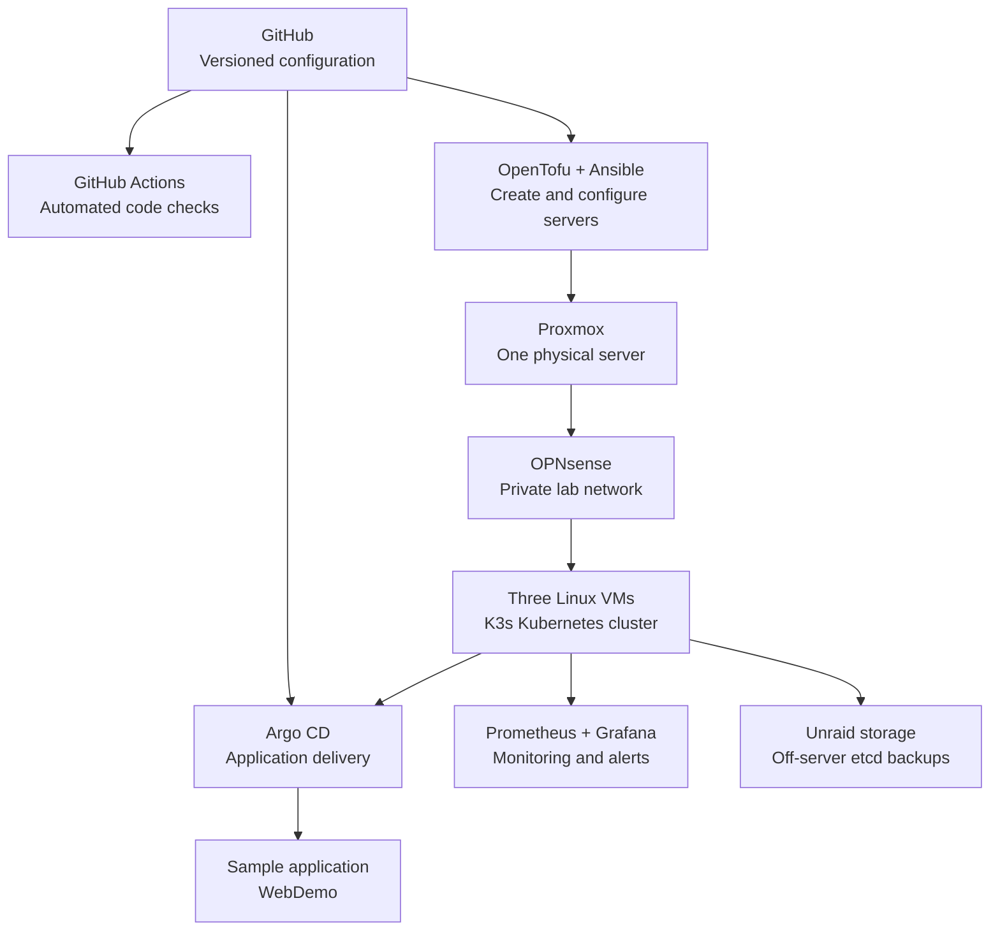

# Homelab Infrastructure Portfolio

### I build, operate, and improve real infrastructure—and document what the evidence proves.

I’m **Lee Austin**, transitioning from manufacturing, field service, and paid computer repair into Linux systems, infrastructure support, and cloud operations. This portfolio is a hands-on lab where I practice provisioning servers, automating configuration, running Kubernetes, monitoring services, and investigating failures.

**In plain language:** I use code to create and configure three Linux servers, connect them on a private network, run applications on them, and test how the system responds when something goes wrong.

[Résumé (PDF)](resume/Lee_Austin_Infrastructure_Support_Resume_2026.pdf) · [GitHub profile](https://github.com/Capasiter) · [LinkedIn](https://www.linkedin.com/in/leeaustinmn/) · [Latest release: v0.9.0](https://github.com/Capasiter/homelab-portfolio/releases/tag/v0.9.0)

## The project at a glance

| What I built | What I tested |
|---|---|
| Three Linux virtual machines running a Kubernetes cluster | Application updates while sending live web requests |
| Repeatable server creation and setup using OpenTofu and Ansible | Configuration can be rerun without making unnecessary changes |
| A private lab network and a stable address for the Kubernetes API | Kubernetes API access during a controlled failover exercise |
| Monitoring, alerts, and off-server backup workflows | Whether alerts recover and whether backup files pass integrity checks |
| Argo CD for deploying a sample application from Git | Whether it notices a changed setting and can restore the intended version |

**Latest delivered milestone:** Argo CD detected that a sample application had been changed from three copies to four, then a manual sync restored the intended three. [See the configuration and evidence](kubernetes/argocd/README.md).

> **Important scope:** All three Kubernetes servers run as virtual machines on **one physical Proxmox host**. The project tests recovery from selected software and process failures; it does not claim protection from physical host failure. The full Kubernetes control-plane restore is still incomplete.

## Start here

If you have a minute, these are the best places to begin:

1. [See how the system is connected](#how-the-system-fits-together).
2. [Read three short engineering stories](#engineering-stories).
3. [Open the live test results](#what-the-tests-show).
4. [Browse the implementation](#explore-the-project).
5. [Download my résumé](resume/Lee_Austin_Infrastructure_Support_Resume_2026.pdf).

## How the system fits together

The diagram shows the main parts and how they connect. The colors distinguish automation, running services, recovery data, and access/network components.

**What those names mean:**

- **Proxmox** runs the virtual machines, like a computer running several separate computers.
- **OpenTofu** describes the virtual machines and network settings in files, so they can be recreated consistently.
- **Ansible** configures Linux and installs the software on those machines.
- **Kubernetes (K3s)** runs and manages the sample application across the three virtual machines.
- **Argo CD** watches application configuration in Git and helps apply it to Kubernetes.
- **Prometheus and Grafana** collect and display system health information.
- **etcd** stores Kubernetes’ configuration data. Its snapshots are saved to separate Unraid storage.

GitHub Actions checks formatting and configuration. It does **not** deploy changes to my live lab. Administrators reach the lab through a restricted SSH bastion, and the Kubernetes API is not public.

## What the tests show

These are results from specific documented exercises, not uptime guarantees.

| Exercise | Observed result | Details |
|---|---|---|
| Update an application while it receives requests | 148 successful requests and 0 observed failures in one protected rollout; a separate check recorded 120 successful requests and 0 failures | [Rolling-update test](kubernetes/k8s-learning/README.md) |
| Rerun server and cluster configuration | Ansible reported `changed=0` on the documented full rerun, meaning it found the machines already matched the requested settings | [Node validation](ansible/docs/k3s-node-validation.md) · [Cluster validation](ansible/docs/k3s-cluster-validation.md) |
| Move the Kubernetes API address after deleting its current owner pod | The address moved from server 02 to server 03; no failed API probes were recorded; all three nodes were Ready afterward | [API failover test](ansible/docs/k3s-api-vip-validation.md) |
| Exercise an alert | Observed the system move from healthy, to a controlled failure and firing alert, then back to healthy | [Monitoring validation](kubernetes/observability/README.md) |
| Check infrastructure for unexpected differences | Documented full OpenTofu checks reported no changes | [Provisioning validation](proxmox/opentofu/docs/k3s-live-validation.md) |
| Verify backup files and investigate restore | Snapshot checksums and decompression were verified; a full etcd restore hit a repeatable K3s reset-path error and is not claimed as complete | [Backup and restore record](docs/portfolio-history-through-v0.7.md#restore-validation) |
| Test GitOps drift detection | Argo CD detected replica-count drift; manual reconciliation returned the application to Synced, Healthy, and 3/3 available replicas | [GitOps validation](kubernetes/argocd/README.md) |

The Actions badge above reports repository checks. It does not represent live cluster health.

## Engineering stories

### A deployment was green, but users still saw a timeout

The first rolling restart completed successfully according to Kubernetes, but a web request still timed out during the update. I added readiness checks and a graceful drain period, then configured the update to keep existing copies available while replacements became ready.

**Evidence:** 148 successful requests and no observed failures during the protected rollout test. [Read the test and implementation](kubernetes/k8s-learning/README.md)

### A backup copy is only useful if it can be trusted and restored

Live testing uncovered file ownership and checksum-file problems in the network storage workflow. I adjusted the export and made checksum files update safely. The backup process now verifies snapshot integrity and keeps a baseline plus three rolling backups.

I also attempted an isolated restore. The snapshot decompressed, but K3s encountered a repeatable error during reset. I document this as incomplete recovery work rather than presenting the backup as a successful restore. [Read the findings and limitation](docs/portfolio-history-through-v0.7.md#current-milestone---k3s-backup-and-recovery-readiness-v070)

### The Kubernetes API address moved when its owner pod was removed

I deleted the pod currently managing the API’s virtual IP while repeatedly checking the Kubernetes API through that address. Ownership moved from server 02 to server 03, the deleted pod was replaced, and all three nodes returned Ready.

This was a controlled pod-level test. It did not simulate a powered-off server, a failed network, or loss of the physical Proxmox host. [Read the method and evidence](ansible/docs/k3s-api-vip-validation.md)

## Explore the project

| If you want to learn about… | Start here |
|---|---|
| Creating the virtual machines and private lab network | [OpenTofu project](proxmox/opentofu/) |
| Linux setup and Kubernetes installation | [Ansible roles and playbooks](ansible/) |
| Application deployment and update testing | [Kubernetes learning project](kubernetes/k8s-learning/README.md) |
| Monitoring, dashboards, and alerts | [Observability project](kubernetes/observability/README.md) |
| Git-based application delivery | [Argo CD configuration](kubernetes/argocd/README.md) |
| Automated repository checks | [GitHub Actions workflow](.github/workflows/infrastructure-validation.yml) |
| Detailed milestone history | [Portfolio history](docs/portfolio-history-through-v0.7.md) · [Changelog](CHANGELOG.md) |

## What is still in progress

A useful portfolio should make the limits clear as well as the successes.

- **One physical host:** Three virtual machines provide multiple Kubernetes control-plane members, but they all depend on the same physical server.
- **Full disaster recovery:** Snapshot integrity and decompression have been checked; a complete etcd restore has not succeeded yet.
- **Application storage:** The Unraid-backed storage demo has documented persistence and single-file recovery checks. Full-volume recovery and application rescheduling across nodes still need testing.
- **Failover scope:** The recorded API exercise removed a Kubernetes pod. It did not test a whole server or host failure.
- **GitOps operation:** Argo CD sync is manual. Automatic correction and pruning are disabled.
- **Monitoring:** External alert delivery and redundant probing remain future work.

## Security and working practices

- Keep the lab network private and use restricted SSH access.
- Keep credentials, private keys, Kubernetes access files, state files, and saved plans out of Git.
- Pin installation artifacts and verify their SHA-256 checksums.
- Use read-only permissions for repository CI; do not expose infrastructure credentials to public checks.
- Validate configuration before restarting services and document the outcome.
- Use pull requests and change review for infrastructure updates.

[More security details and documented tradeoffs](docs/portfolio-history-through-v0.7.md#security)

## About Lee

I’m moving into Linux systems, infrastructure support, and cloud operations after working in manufacturing, field service, and paid computer repair. I learn by building working systems, testing them, troubleshooting what fails, and writing down what the results do—and do not—show.

**Roles I’m pursuing:** Linux / Infrastructure Support · Systems Administration · Cloud Operations · Junior DevOps

[Résumé (PDF)](resume/Lee_Austin_Infrastructure_Support_Resume_2026.pdf) · [LinkedIn](https://www.linkedin.com/in/leeaustinmn/) · [GitHub](https://github.com/Capasiter)

---

Future ideas (proposed, not deployed)

The following ideas are experiments under consideration, not capabilities currently claimed as deployed: a dedicated Linux agent VM for supervised local AI assistance, expanded log collection, a Kubernetes dashboard, automated certificate management, and broader network policies. Any future automation will use limited access and human-reviewed changes.

